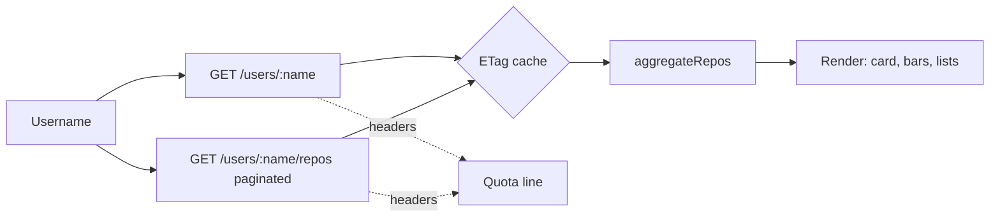

# Architecture — DevMetric

**Shape:** three static files — `index.html`, `styles.css`, `app.js`. No build, no framework, no chart library (bars are divs).

**Data flow:**

**Layers inside app.js:**
1. **API layer** — `fetchCached()`: attaches the optional token, sends `If-None-Match` when a cached ETag exists, reads rate-limit headers on *every* response (including errors), maps 304 → cached data, and throws typed errors (404 / 403+reset / network).
2. **Mapper/aggregation** — `mapProfile()` (incl. account age) and `aggregateRepos()` (fork filtering, totals, language counts, top/recent sorts).
3. **State** — current username, last quota snapshot.
4. **Render** — profile card, language bars, repo lists, quota line.

**Caching design:** per-URL entries in localStorage `{etag, data}`. Conditional requests that return 304 do not count against GitHub's rate limit — the cache literally buys quota.

**Pagination:** sequential pages of 100; stop at the first short page; hard cap 5 pages.
